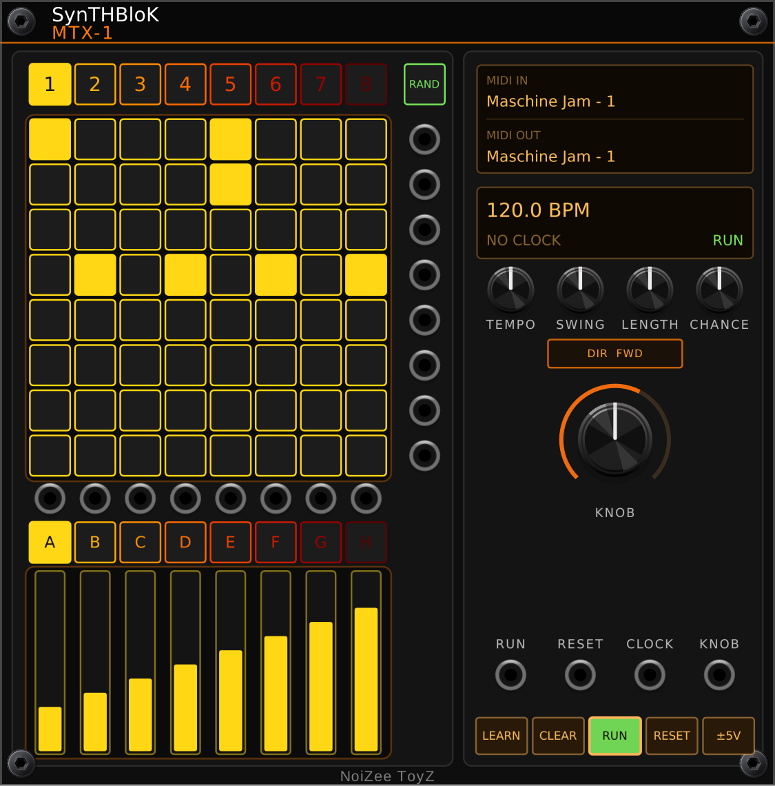

# SynTHBloK MTX-1

A free VCV Rack 2 plugin by **NoiZee ToyZ** (part of the SynTHBloK series).



| Module | What it does |
|---|---|
| **MTX-1** | Maschine JAM controller: 8x8 pad trigger sequencer with 8 patterns, plus the 8 touch strips as CV outputs with 8 banks; JAM lights follow the module |

## Install

In VCV Rack 2: **Library**, search **SynTHBloK MTX-1**, **Add**.

## Build

```
make RACK_DIR=/path/to/Rack-SDK   # or: make dist / make install
```

## Licence

GPL-3.0-or-later (see `LICENSE.txt`). The SynTHBloK and NoiZee ToyZ names and logos are not covered by the licence.
